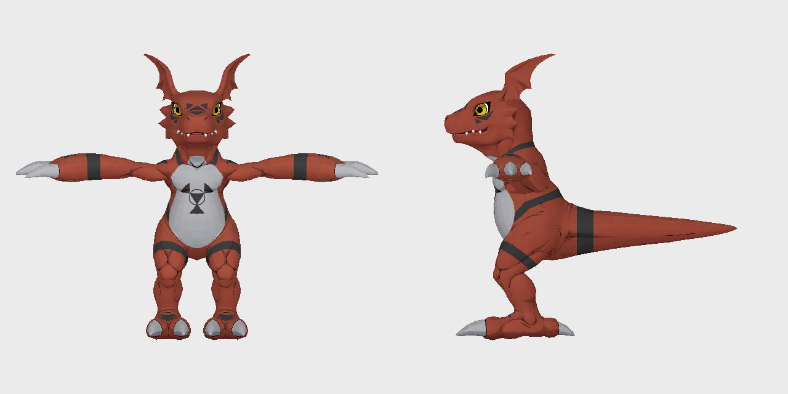
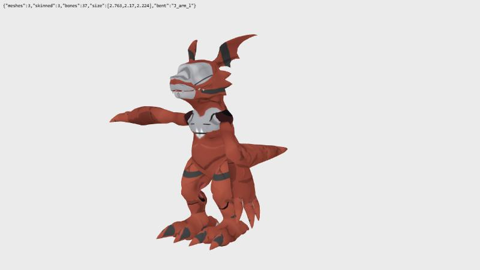

# TS-202: Read Time Stranger's model format

| | |
|---|---|
| Trello | https://trello.com/c/fkaEh4xz |
| Phase | 2 Models |
| Feature branch | `time-stranger` (all 45 new cards complete before merging to `main`) |
| Depends on | TS-201 |

## Goal

Read a Time Stranger Digimon model completely: mesh, skeleton, skin weights, materials, textures.

## Context

- `extracted_ts/` from TS-201.
- REA for the parser in the executable.

## Steps

1. Find Guilmon's model file (or any Digimon's, then Guilmon's).
2. Read the mesh (positions, normals, UVs, vertex colours, index buffers, submeshes), the skeleton (bone tree, names, bind pose), the skin weights and the materials/textures (texture format and how it is decoded).
3. Write `tools/ts_model_read.py` and a dump to glTF (`.glb`) for inspection.
4. Open the dump in a viewer and compare with the game.

## Acceptance criteria

- [x] Guilmon's `.glb` shows the right shape, textures and a bind pose matching the game (screenshot in the log).
- [x] README: the format, field by field, with where it was read.

## Out of scope

- Animations (TS-203).
- Conversion (TS-205).

## Questions for the owner

- None open. (2026-10-13: whether Guilmon in the two pictures of the log looks as it does
  in the game; answered under Decisions.)

## Decisions

- 2026-10-13, the owner: Guilmon in the log's pictures matches the game (shape, colours, stance).

## Log

<!-- Date, what was done, what was found and where (addresses, URLs, commits). -->

### 2026-10-14, correction (TS-207)

**The pictures of this ticket that show a model's paint were wrong until today.** The
reader took a texture coordinate's second number from the picture's top row; it counts
from the bottom row (README, "Time Stranger models", "Attributes"). `img/ts-202-guilmon.png` was made again
with the corrected reader. `img/ts-202-guilmon-glb.jpg` was not: it shows the old paint (a
white snout, narrowed eyes). A `.glb` written now has the right coordinates.

### 2026-10-13

**Guilmon's model is `chr090`.** The row of `char_GUILMON` in `data/char_info.mbe` holds
`chr090` (and `1090`), and `data/digimon_status.mbe` has the same pair. Which column means
what was not read here (TS-203). Its files in `app_0`: `chr090.geom` (2.2 MB),
`chr090.nlst`, `chr090_lod_2.geom`, 11 textures `images/chr090*.img`, 21 motions
`chr090_*.anim`.

**The format** is in the README, "Time Stranger models", field by field with the routine
or the check behind each. Read with `tools/x64.py`:

| Address | What |
|---|---|
| `0x1402dec00` | the `.geom` loader: version `0x13c` (`0x1402dedcf`), the flags for `.vert` and `.name` files, the offsets turned into pointers, the materials' textures looked up |
| `0x14035f260` | builds the Direct3D input layout from a mesh's vertex attributes |
| `0x14165bd30` | the semantic name of each attribute kind (POSITION, NORMAL, TANGENT, BINORMAL, TEXCOORD ×4, COLOR, BLENDINDICES, BLENDWEIGHT, PSIZE, Color1) |
| `0x141ac4f00` | the shader parameter table, 0x38 bytes a row: the names of the material parameters (`ColorSampler` is 0x18) |
| `0x1402e04b3`, `0x1402e05f0` | match the records of the tables at +0x58 and +0x60 to bones by hash; show the skeleton's bone count (+0x10) and hash list (+0x20) |

**Read from the data and checked**, not from a routine: the mesh record's counts and
offsets (each block ends where the next begins), the triangle strips, the skeleton's
parents and rest pose, the inverse bind matrices. The check that ties the last three
together: inverse bind matrix × rest matrix of the bone = unit matrix, to 0.000005, for
all 37 bones of Guilmon and for every bone of 495 of the 532 `chrNNN.geom`. In the other
37 models a few face-shape and effect bones (`J_close_l`, `J_smile_l`, `ef_b_l` …) are at
rest in another pose than the bind pose; every other bone of theirs passes.

**Guilmon**: 37 bones (`GRP_joint`, `J_root`, `J_center`, legs, five tail bones, spine,
neck, head, mouth, ears, arms, `GRP_mesh`, `mvglDummy0000`), 6 meshes:

| Mesh | Material | Vertices | Triangles | Skin |
|---|---|---|---|---|
| `chr090` | `chr090_b01` (body) | 22,836 | 7,612 | 33 bones, 4 weights |
| `chr090` | `chr090_f01` (an eye) | 213 | 71 | 1 bone |
| `chr090` | `chr090_f02` (the other eye) | 213 | 71 | 1 bone |
| `eye_L` | `chr090_eye_L` (blended) | 240 | 112 | 1 bone |
| `eye_R` | `chr090_eye_R` (blended) | 240 | 112 | 1 bone |
| `outline` | `MTR_line01` (black, no texture) | 23,262 | 7,754 | 33 bones, 4 weights |

The body's strip uses 4,736 of its 22,836 vertices; the others are not drawn by it.
Textures are DDS: `chr090a01` 1024×1024 BC1 (colour), `a01n`, `a01m`, `a01l`, `a01s`
(256×256), `p01` (pupils, BC7), `b01` (eyelids in four shapes, BC7), `b01n`, `b01m`,
`e01` (8×8), `e01h`.

**The tool.** `tools/ts_model_read.py <geom>` prints the above; `--glb` writes a glTF
binary (bones as nodes, skin with the file's inverse bind matrices, `ColorSampler` as the
base colour); `--png` draws front and side. It reads all 532 `chrNNN.geom` of `app_0`.

**Seen.** Drawn by the tool, with `--overlays` (the eyes' two overlay textures laid over
the colour texture; that mixing is this project's guess, not the shader's):

The `.glb` opened in three.js r160 (GLTFLoader) in the browser: 3 skinned meshes, 37
bones, size 2.763 × 2.170 × 2.224, the colour texture in place. With `J_arm_l` turned 70°
the left arm bends at the shoulder and nothing else moves, so the weights and the palette
are right:

A second model, `chr100`, was drawn too and is whole.

**Not seen.** The game itself was not run: the pose was checked against the game's own
inverse bind matrices, not against a screenshot. In the `.glb` the eyes are blank, since
glTF has nowhere for the overlay textures; the outline shell and the two blended eye
meshes are left out unless `--all`. What the shaders do with the other textures (mask,
light weight, CLUT, normal) was not read.

**For TS-205.** The body uses one 1024×1024 colour texture; the eyes need the overlays
baked in. Y is up, the model faces +Z, and Guilmon is 2.16 units to the tips of its ears with its feet at
y = 0.
