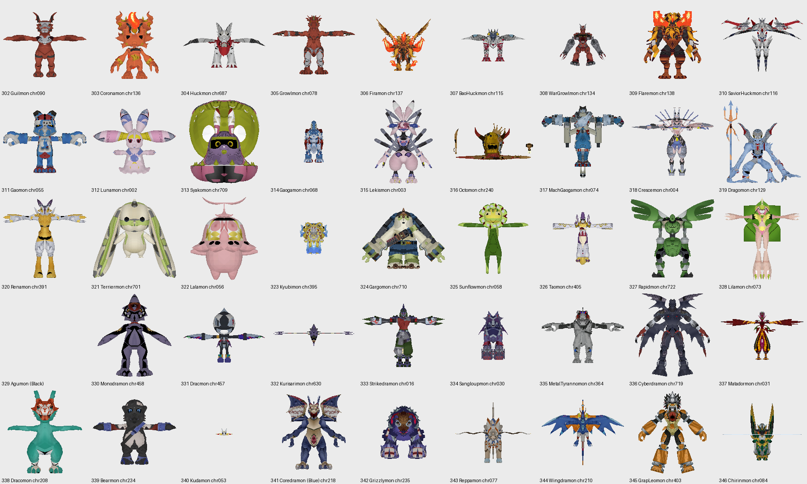
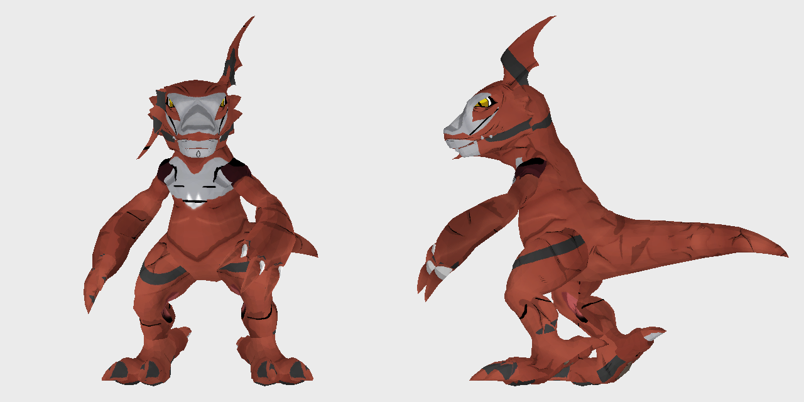
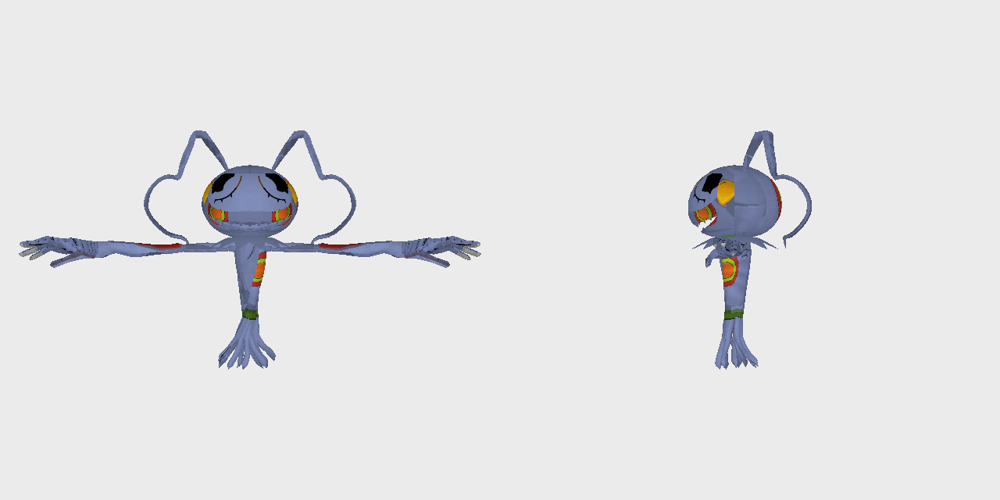

# TS-203: Find each Digimon's model and animations

| | |
|---|---|
| Trello | https://trello.com/c/9HUw0jL2 |
| Phase | 2 Models |
| Feature branch | `time-stranger` (all 45 new cards complete before merging to `main`) |
| Depends on | TS-202 |

## Goal

For all 45 Digimon, know which file is its model and which of its animations are idle, attacks, damage, defeat and victory.

## Context

- [roster.md](roster.md) "TS model" column.
- TS-204 for what DDCB needs.

## Steps

1. Find the table that ties a Digimon id/name to its model and animation files; read it.
2. Read the animation format (tracks per bone, rotation encoding, key times, frame rate).
3. List Guilmon's animations with ids/names and lengths; find which is which from the game's own names or the battle code that plays them, not from looking at them.
4. Fill the TS model column for all 45.

## Acceptance criteria

- [x] All 45 rows have their model file. (all 45 current rows from Time Stranger, including Keramon/chr626 in slot 329.)
- [x] Guilmon's animation list with the role of each, and where the role was read.
- [x] README: the animation format and the table, with sources.

## Out of scope

- None.

## Questions for the owner

- None.

## Decisions

- Owner correction: replace the Fire black Agumon variant with Keramon (329/428);
  Phase 2 uses chr626. All nine Darkness models are to be converted.

## Log

<!-- Date, what was done, what was found and where (addresses, URLs, commits). -->

### 2026-10-13 — the models

**The tables.** `.mbe` files are `EXPA` tables with their strings in a `CHNK` block;
`tools/ts_mbe.py` reads them. The reader in the executable is `0x140dcf480` (magic checks
at `0x140dcf6cf` and `0x140dcf992`). The column types were worked out from the rows (README,
"Time Stranger tables"): 2, 3, 4 integers of 32, 16 and 8 bits, 5 float, 6/7/8 string, 9 one
bit, 10 no room. That fits 2,787 of the 2,788 tables of `app_0/data` (740 files); the one
left has a type 0 column.

**Name to model.** `text/char_name.mbe` (`app_text01`, English) gives the key of a name,
`char_GUILMON`; `data/char_info.mbe` gives the key's model in column 3, `chr090`. The
`patch` archive has a newer `char_info.mbe` (839 rows against 836); the 45 rows wanted are
the same in both.

All 45 current identities are found by their exact English name and are in [roster.md](roster.md).
Their keys are the Japanese names: Huckmon `char_HACKMON`, Growlmon `char_GROWMON`,
WarGrowlmon `char_MEGAGROWLMON`, Syakomon `char_SHAKOMON`, Octomon `char_OCTMON`, Dragomon
`char_DAGOMON`, Dracmon `char_DRACUMON`, Matadormon `char_MATADRMON`, Grizzlymon
`char_GRYZMON`, Chirinmon `char_TYILINMON`.

All 45 current models were read with `tools/ts_model_read.py` and drawn (`--overlays`); they are
the Digimon their rows name:

**Historical finding, superseded:** Agumon (Black) was not in this build. Neither `char_name.mbe` nor
`char_info.mbe` (of `app_0` and of `patch`) has a row for it: the names holding "agumon"
are Agumon, Agumon (Bond of Bravery), Pagumon, ToyAgumon (two rows) and Agumon & Gatomon.
The field guide the roster was checked against lists it as no. 468. See the question to
the owner.

### 2026-10-13 — the motions

**The format** is in the README, "Time Stranger motions". None of it was read from a
routine (the loader, `0x1402dcd60`, only reads the file in); it was worked out from the
files and checked: the chunk sizes and the bit table agree exactly in every chunk of the
11,321 motions `tools/ts_anim_read.py` reads (of 11,333 `chrNNN_*.anim` in `app_0`; the
other 12 have unchanging float channels and are refused). 30 frames a second in 11,235 of
them. The packed rotations were settled by which reading keeps neighbouring values close,
and by posing Guilmon:

The last frame of `bd03` and frame 45 of `bv01` were drawn too and are whole poses.

**Guilmon's motions** (`chr090_*.anim`, all 30 frames a second, 37 bones):

| Motion | Frames | Seconds | Number in the battle code | What was read about it |
|---|---|---|---|---|
| `bn01` | 41 | 1.333 | 0 | a Digimon on the field stands with it (`field_move_animation`) |
| `bn02` | 81 | 2.667 | 1 | |
| `ba01` | 53 | 1.733 | 2 | |
| `ba02` | 51 | 1.667 | 5 | |
| `bg01` | 29 | 0.933 | 7 | |
| `bg02` | 29 | 0.933 | 8 | |
| `bd01` | 29 | 0.933 | 9 | |
| `bd02` | 25 | 0.800 | 10 | |
| `bd03` | 56 | 1.833 | 11 | |
| `fe02` | 56 | 1.833 | 12 | |
| `fe04` | 51 | 1.667 | 13 | |
| `bv01` | 87 | 2.867 | 31 | `bv02`, `bv03` are in the table `battle_extra_win` |
| `br01` | 25 | 0.800 | 32 | a Digimon on the field moves with it (`field_move_animation`) |
| `bs01` | 51 | 1.667 | 34 | |
| `bf01` | 41 | 1.333 | | |
| `fe01`, `fe03` | 81, 91 | 2.667, 3.000 | | |
| `fq01`, `fq02` | 41, 49 | 1.333, 1.600 | | |
| `fn02_01` | 61 | 2.000 | | |
| `f000` | 401 | 13.333 | | |

Beside them: `chr090.anim` and `chr090_lod_2.anim` (one frame, no channels),
`chr090loc*.anim`, `cam_chr090_*.anim` and `ef_b_chr090_bs01.anim` (not character motions).

**The numbers.** The battle code keeps a motion for each of 74 numbers and gets its name
through `0x140c46320`, which calls `0x140c45e50` (numbers to rows 1 to 52 of
`battle_define_string` in `data/battle_calculate.mbe`) or `0x140c45c00` (rows 53 to 78);
`0x1409cdb00` fetches the row's string. `0x140a1ba30` fills a unit's 74 slots this way.

**The roles** are in the next entry.

### 2026-10-13 — the roles

**The game names its motion numbers itself.** `lua/battle_define.lua` (Lua 5.2 bytecode;
`tools/ts_luac.py` lists the globals a script sets) has `MOTION_TYPE_IDLE = 0`,
`MOTION_TYPE_TIRED = 1`, `MOTION_TYPE_ATTACK = 2` … `MOTION_TYPE_ITEM_02 = 49`: 40 names
in `app_0`, 41 in `patch` (`ITEM_02` is new there). With the code's table of the entry
above (number to row of `battle_define_string` to motion name) that gives Guilmon's
motions their roles:

| Motion | Number | The game's name for it |
|---|---|---|
| `bn01` | 0 | `MOTION_TYPE_IDLE` |
| `bn02` | 1 | `MOTION_TYPE_TIRED` |
| `ba01` | 2 | `MOTION_TYPE_ATTACK` |
| `ba02` | 5 | `MOTION_TYPE_COMMON_SKILL` |
| `bg01` | 7 | `MOTION_TYPE_GUARD` |
| `bg02` | 8 | `MOTION_TYPE_AVOID` |
| `bd01` | 9 | `MOTION_TYPE_DAMAGE` (and `DAMAGE02`, `DAMAGE03`, the same number) |
| `bd02` | 10 | `MOTION_TYPE_DOWN` |
| `bd03` | 11 | `MOTION_TYPE_UP` |
| `fe02` | 12 | `MOTION_TYPE_HAPPY` |
| `fe04` | 13 | `MOTION_TYPE_ANGRY` |
| `bv01` | 31 | `MOTION_TYPE_WIN` |
| `br01` | 32 | `MOTION_TYPE_RUN` |
| `bs01` | 34 | `MOTION_TYPE_SPECIAL_SKILL01` |

`bd03` being "up" fits what was drawn: its last frame is Guilmon standing again.
Guilmon has no motion for `ATTACK02`, `ATTACK03`, `ITEM`, `LOSE` or the others; the code's
table gives those numbers no row among the first 52.

**How sure.** The names are the script's and the number-to-motion table is the code's
(`0x140c45e50`). That both use the same numbers was not read from a routine; the scripts of
single battles show it: `lua/battle_10400200.lua` holds `MOTION_TYPE_IDLE` with `bn01`,
`TIRED` with `bn02`, `DAMAGE` with `bd01`, `DOWN` with `bd02`, `UP` with `bd03`, `GUARD`
with `bg01`, as the table has them (it also swaps `ATTACK` and `COMMON_SKILL` for its
enemy).

**Not read:** `bf01` and the field motions `fe01`, `fe03`, `fq01`, `fq02`, `fn02_01`,
`f000` have no number in the battle table and no role here.

**Tried before the script was found** (so nobody repeats it): following the callers of
`0x140c46320` and of the unit's 74 motion slots (`0x140a1ba30`) to the battle state
classes. The callers pass the number in a variable, and the constants in the classes
`BattleDirectionWin`, `BattleDirectionDead`, `BattleTimetableSlotGuard` are other things
(the last returns its own slot type, 7).

**For TS-204 and TS-206:** the candidates for DDCB's slots are `bn01` (idle), `ba01`
(attack), `ba02` (common skill), `bs01` (special skill), `bg01` (guard), `bd01` (damage),
`bd02` (down), `bv01` (win), all 30 frames a second.

### 2026-10-13 — owner correction: Keramon replaces Agumon (Black)

Current slot 329 is Keramon, Darkness/R, base Tsukaimon (135), placeholder model 428.
Initially its numbers/effects were copied from Tsukaimon; TS-106 supersedes that
with original gameplay (card-design.md). Local char_KERAMON → chr626 is
present in both model tables; Phase 2 converts all nine Darkness models. The old
black Agumon exception is superseded. Official EX1-044 crop [80,105,320] needs no
restoration and is shared by both art modes. Offset 20000 is retired; the four other
published offsets remain stable. [Full evidence and current roster](roster.md).

