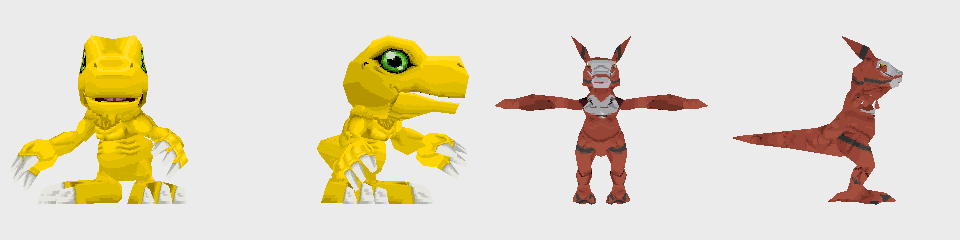
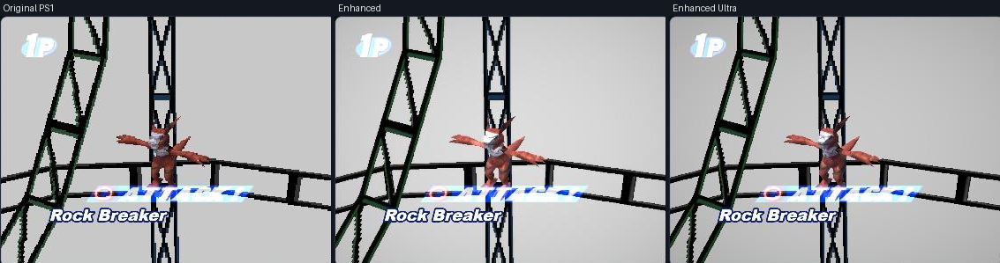

# TS-205: Converter: mesh and texture to the DDCB model format

| | |
|---|---|
| Trello | https://trello.com/c/2nugKL0f |
| Phase | 2 Models |
| Feature branch | `time-stranger` (all 45 new cards complete before merging to `main`) |
| Depends on | TS-202, TS-204 |

## Goal

Turn a Time Stranger model into a DDCB model file (`web/assets/models/NNN.*`) that looks like the Digimon in the 320x240 scene and costs what a disc model costs.

## Context

- `tools/build_models.py` docstring: the DM format (rigid parts, vertex = x y z nx ny nz r g b u v part palette-row, opaque then blended triangles, texture as colour indices + palette rows).
- Budget of the disc's models: 16-23 parts, about 640-880 triangles, texture up to 256x128, up to 12 palette rows; 8 motions each.
- `js/battlehd.js`: Smooth subdivides x16 and must fit 16-bit indices.
- TS-204: the base's scripts hang effects on body parts by their number in the model (the "Parts" columns of [motion-slots.md](motion-slots.md)); the converted model needs a part with that number in that place.
- CLAUDE.md: the scene stays 320x240; no depth buffer in Original PS1.

## Steps

1. `tools/ts_model.py <ts model> <base card> <model number>`: bind every vertex to its heaviest bone; merge bones with few vertices into their parent until there are no more parts than the base has (log the merges).
2. Decimate the mesh to the base's triangle count, keeping UV seams.
3. Bake the textures into one sheet no larger than 256x128, quantised to the palette size the format uses, at most 12 rows; split triangles that cross palette regions as the disc models do.
4. Scale and turn the model to the base's height and facing (base's bounding box in its idle pose).
5. Where the reduced texture loses detail that reads at 320x240 (eyes, markings) or shows seams, touch it up through ComfyUI (TS-004) before quantising; log each edit.
6. Write the bind pose as a one-key motion in all 8 slots for now.

## Acceptance criteria

- [x] Guilmon written as model 401 stands in `battle-preview.html` in Original PS1, Enhanced and Smooth (screenshots in the log). (Checked with the files in place, then put back: see the log.)
- [x] Parts, triangles, texture size and palette rows within the base's figures.
- [x] `node tools/battletest.js` validates it.

## Out of scope

- Motions (TS-206).

## Questions for the owner

- None.

## Log

<!-- Date, what was done, what was found and where (addresses, URLs, commits). -->

### 2026-10-14, correction (TS-207)

**The pictures of this ticket that show a model's paint were wrong until today.** The
reader took a texture coordinate's second number from the picture's top row; it counts
from the bottom row (README, "Time Stranger models", "Attributes"). The two pictures below show
Guilmon with the old paint, and the figures are those of the converter before TS-207
changed it; they are left as the record of that state.

### 2026-10-14

**The tool.** `tools/ts_model.py <file.geom> <web dir> <base model number> <out dir>
<number> [--part N=<bone>] [--preview out.png]` (the ticket's shorter call would have to
look the files up; this one is given them). What it does at each step, and that every
choice in it is this project's and not the game's, is in the README, "Time Stranger models
as DDCB models".

**What the disc's models cost**, measured over the 211 card models of `web/assets/models`:
2 to 31 parts (median 20), 380 to 1,246 triangles (median 710), 1 to 16 palette rows, every
texture 16 colours a row, 83 of them 256×128, and no triangle with corners in different
parts. The ticket's "about 640-880 triangles, up to 12 rows" is the middle of that.

**Guilmon** (`chr090`) on Agumon's model 3 (16 parts, 690 triangles, 256×124, 3 rows):

| | Base | Guilmon |
|---|---|---|
| Parts | 16 | 16 |
| Triangles | 690 | 690 (from 7,754; 12 of them the eyes') |
| Vertices | 937 | 699 |
| Texture | 256×124 | 256×124 |
| Palette rows | 3 | 3 |

- Parts: 33 bones carry vertices; 17 were merged into their parents, smallest first (the
  five tail bones, spine, neck, collars, elbows, thighs, nails and ears). Left: `J_spine02`
  (0), `J_center`, knees, feet, toes, head, arms, mouth, hands, fingers.
- Part 0 is `J_spine02`: Agumon's first attack (script 554) hangs an object on part 0
  (`motion-slots.json`). By its place in Agumon's model that part is the chest: 27
  vertices, the parent of the head's part and of both arms'.
- Texture: 28 pieces in 3 groups of shared texels (the body's one big piece, each eye),
  shrunk to 0.254 across and 0.102 down. Row 0 is the body's 16 colours, rows 1 and 2 the
  two eyes'.
- Scale 115.66: 2.170 high in Time Stranger, 251 here; Agumon stands from y −249 to 1.

**Seen in the browser.** The converted files were put in place of
`web/assets/models/401.*` and looked at in `battle-preview.html` (Guilmon against
Garurumon, stage 13, Rock Breaker, paused at frame 31) in the presets Original PS1,
Enhanced and Enhanced Ultra, which draw the model as written, refined and smooth
(`preset()` in `web/js/battle3d.js`): Guilmon stands in the arena on the ground, upright, the right size beside
the stage, textured, in the bind pose with its arms out. No console errors.

`node tools/battletest.js` with the converted 401 in place: both lines PASS (237 Digimon,
711 attacks × three styles; Smooth meshes).

**Not committed: model 401 itself.** The files in `web/assets/models/401.*` were put back
to the recoloured Agumon after the check. A Guilmon that holds one pose would take the
place of a card that plays today, and `tools/build_custom.py` writes 401 from the card's
recolour anyway; putting the converted model into the build is TS-207's.

**Not done or not right yet:**

- Step 5, the touch-up through ComfyUI: not done. At 320×240 the eyes are a few pixels
  (12 triangles, 326 texels each) and do not read; whether to repaint them into the sheet
  is for the pilot (TS-207).
- The two eyes take a palette row each though their colours are the same, while the whole
  body has one row of 16 colours. A triangle takes its row from its texture piece, and
  the body is one piece; splitting it by colour would need its texels twice.
- A triangle is given whole to one part, as on the disc, so where two parts meet there is
  no skin to stretch: when the motions come (TS-206) joints may open.
- Looked at only in the bind pose and only for Guilmon.
