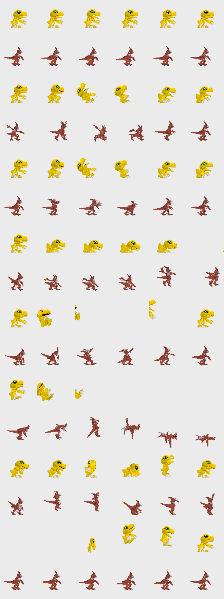

# TS-206: Converter: motions

| | |
|---|---|
| Trello | https://trello.com/c/tzzuM8kp |
| Phase | 2 Models |
| Feature branch | `time-stranger` (all 45 new cards complete before merging to `main`) |
| Depends on | TS-203, TS-204, TS-205 |

## Goal

Give the converted model the eight motions the battle scripts call, taken from its Time Stranger animations, timed so every script still lines up.

## Context

- TS-203: which Time Stranger animation plays each role.
- TS-204: the slot table (README, "Polygon Battle") and each base's slot lengths, key times, loop key, sounds and script timelines: `motion-slots.json`, written by `tools/motion_slots.py` (layout in its docstring), with the bases as a table in [motion-slots.md](motion-slots.md). A motion lasts 2 × d0 + Σ 2 × d frames; the first 2 × d0 are the blend into key 0.
- Motion key layout in `tools/build_models.py`.

## Steps

1. For each slot, sample the chosen Time Stranger animation through the merged-bone tree into keys of per-part rotation, move and scale.
2. Retime it to the base's slot length; place keys where the base has them.
3. Copy the camera record and the sound field of every key from the base's motion at the same time; Time Stranger has neither.
4. A slot without a Time Stranger counterpart uses the nearest role; log it.

## Acceptance criteria

- [x] Guilmon's three attacks, damage, KO and victory play in `battle-preview.html` next to Agumon's, hits and camera at the same moments (frames in the log). (The script's effects, the words and the camera come at the same frames; Guilmon's own strike is not laid on them: see the log.)
- [x] `node tools/battletest.js` and `node tools/sim.js` pass.

## Out of scope

- None.

## Questions for the owner

- None.

## Log

<!-- Date, what was done, what was found and where (addresses, URLs, commits). -->

### 2026-10-14

**The tool.** `tools/ts_model.py` now writes the eight motions too (it wrote the bind pose
held still before). Same call as in TS-205; `--poses out.png` draws the result, `--anims`
and `--motion SLOT=<name>` are for a model whose files or roles differ. What it does and
that every choice in it is this project's is in the README, "Time Stranger models as DDCB
models", under **Motions**.

```bash
tools/.venv/Scripts/python -I tools/ts_model.py extracted_ts/app_0/chr090.geom web 3 <out dir> 401 --part 0=J_spine02 --poses poses.png
```

**How a slot is made.** The base's keys are kept: as many, each as long, with the base's
sound and camera record. So a slot lasts what the base's lasts (2 × d0 + Σ 2 × d, TS-204)
and step 3 of the ticket is exact, not "at the same time" by nearness. Only the parts'
records are new: the pose of the Time Stranger motion at the key's share of the time.

**Guilmon** (`chr090`) on Agumon's model 3:

| Slot | Motion | Its frames (30 a second) | Keys | Frames here | Its frame at each key |
|---|---|---|---|---|---|
| 0 standing | `bn01` | 41 | 6 | 112 | 0 8 16 24 32 40 |
| 1 attack 1 | `ba01` | 53 | 13 | 240 | 0 4.3 8.7 … 47.7 52 |
| 2 attack 2 | `ba02` | 51 | 13 | 240 | 0 4.2 8.3 … 45.8 50 |
| 3 attack 3 | `bs01` | 51 | 21 | 232 | 0 4.3 9.8 15.2 20.7 21.7 … 33.7 39.1 43.5 46.7 50 |
| 4 damage | `bd01` | 29 | 19 | 128 | 0 0.9 1.9 … 25.2 28 |
| 5 KO | `bd02` | 25 | 14 | 144 | 0 0.7 1.4 … 21.2 24 |
| 6 victory | `bv01` | 87 | 21 | 352 | 0 4.3 8.6 … 81.7 86 |
| 7 entrance | `bn01` | 41 | 14 | 124 | 0 1.4 2.8 … 35.9 40 |

Slot 7 has no Time Stranger counterpart (step 4): the battle table of that game has no
motion for coming in, so it takes the standing motion. The site never plays slot 7.
Agumon's standing motion is one of the three on the disc that stop instead of going round
(TS-204), so Guilmon's stops too.



**Seen in the browser.** The converted files were put in place of `web/assets/models/401.*`
(as in TS-205) and each case was stepped frame by frame in `battle-preview.html`, once with
Agumon and once with Guilmon against Garurumon, stage 13, Original PS1. For every frame
the camera's place and turn were compared, and the frames at which a motion starts or
ends, an effect model shows, the words change and the camera changes Digimon:

| Case | Frames | Camera | What happens when (both the same) |
|---|---|---|---|
| Attack 1 (script 554, hit 400) | 424 | the same in every frame | motion 1 from frame 2 to 242 (240), fireball shows at 192, hit script from 254, target's damage 256 to 380 |
| Attack 2 (555, 400) | 424 | the same | motion 2 from 2 to 242, fireball at 192 |
| Attack 3 (556, 480) | 427 | the same | motion 3 from 2 to 234 (232), hit script from 257, its effect model 259 to 295 |
| Victory (attack 1, target at 0 HP) | 709 | the same | motion 6 from 476, "WINNER!!" gone at 679 |
| Damage (Garurumon attacks) | 475 | the same | motion 4 from 307 to 435 (128) |
| KO (Garurumon attacks, 0 HP) | 688 | the same | motion 5 from 307 to 451 (144) |

Looked at, paused: frame 194 of attack 1 (Guilmon upright in mid attack, the script's fire
at its chest, part 0), frame 440 of the KO (Guilmon lying on the ground), frame 600 of the
victory (Guilmon up, "WINNER!!" over it). No console errors.

`node tools/battletest.js` with the converted 401 in place: all three lines PASS (237
Digimon, 711 attacks × three styles). `node tools/sim.js`: 200 matches, no timeouts.

**Not committed: model 401 itself**, as in TS-205: the files were put back to the
recoloured Agumon after the check. Putting the converted model into the build is TS-207's.

**Not done or not right yet:**

- **The strike is not on the script's moment.** The keys are spread evenly over the Time
  Stranger motion. Agumon's first attack fires its fireball at frame 190 of 240; measured on
  the written keys, Guilmon reaches farthest forward at frame 112 in attack 1 and 128 in
  attack 2 (Agumon at 48 in both: it leans in and holds), and at the last key, 232, in
  attack 3 (so does Agumon). When a Time Stranger motion strikes was not looked for in
  that game's files; with it the keys could be laid so that the strike meets the script.
- **The scripts are Agumon's.** Guilmon's card plays scripts 554 to 556: a fireball from the
  chest under "Rock Breaker". That is the card's (TS-101), not the converter's.
- **The tail is one piece.** Its five bones were merged into the hips to fit 16 parts
  (TS-205), so it does not bend; in the KO pose it reaches 100 below the ground the feet
  stand on (the model is 251 high).
- **Attack 3 ends in the air**: the last frame of `bs01` has Guilmon's lowest point 43
  above the ground. The script's return to standing blends it down.
- **KO ends more than half a turn from the standing pose in its numbers** (the tool says
  so). Nothing follows a KO in a battle, so the swing back is not seen.
- Joints may open where rigid parts meet, as TS-205 expected: not looked at closely (small
  pictures at 320×240), and only for Guilmon.
- The victory motion goes round from key 1 in the base. The tool lays a motion on the round
  only when the base goes round from key 0, so each round of the victory blends from the
  last pose of `bv01` back to key 1's.
