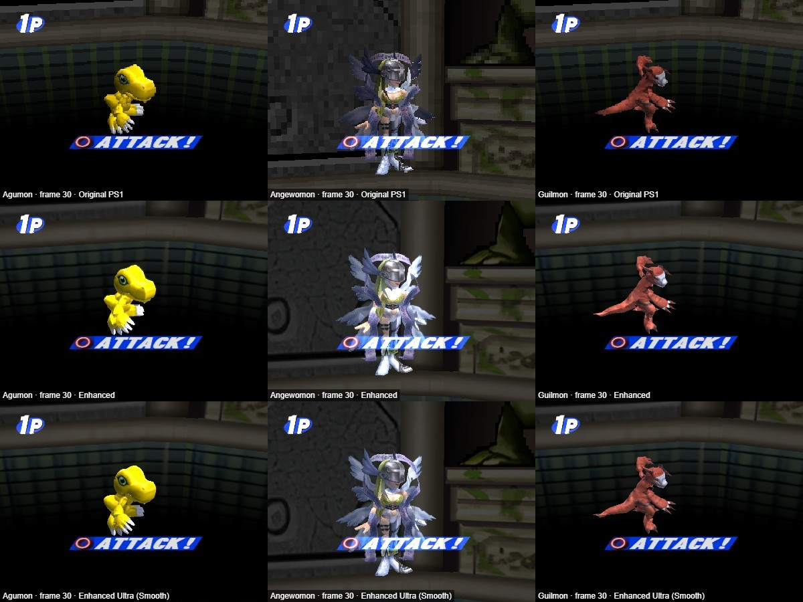
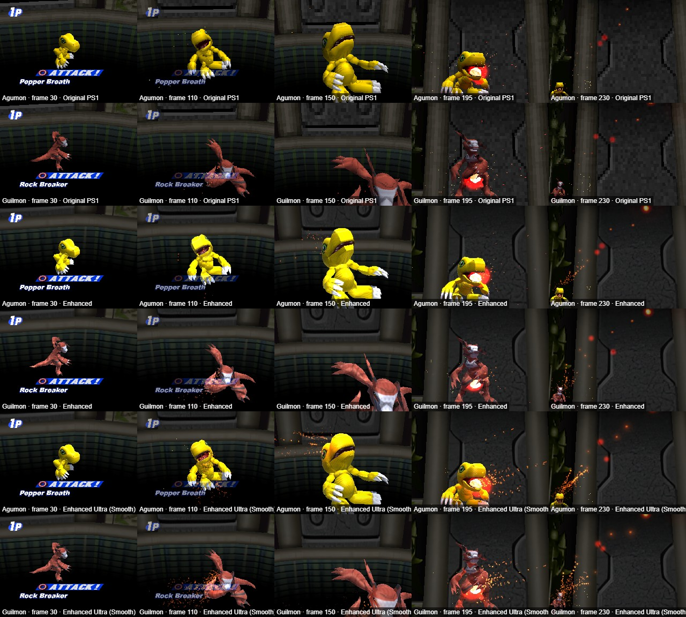
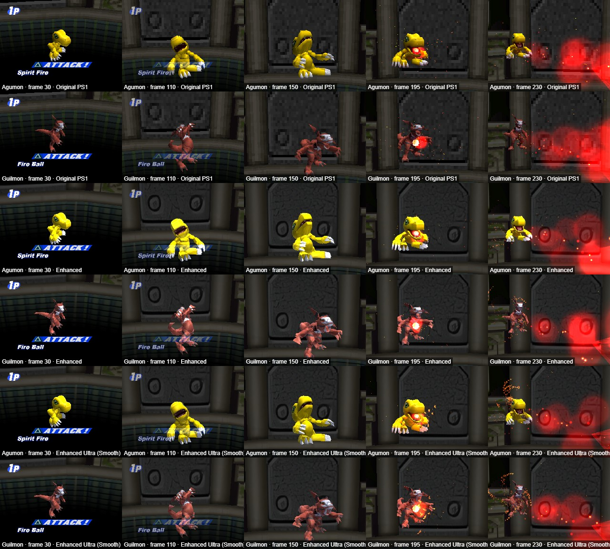
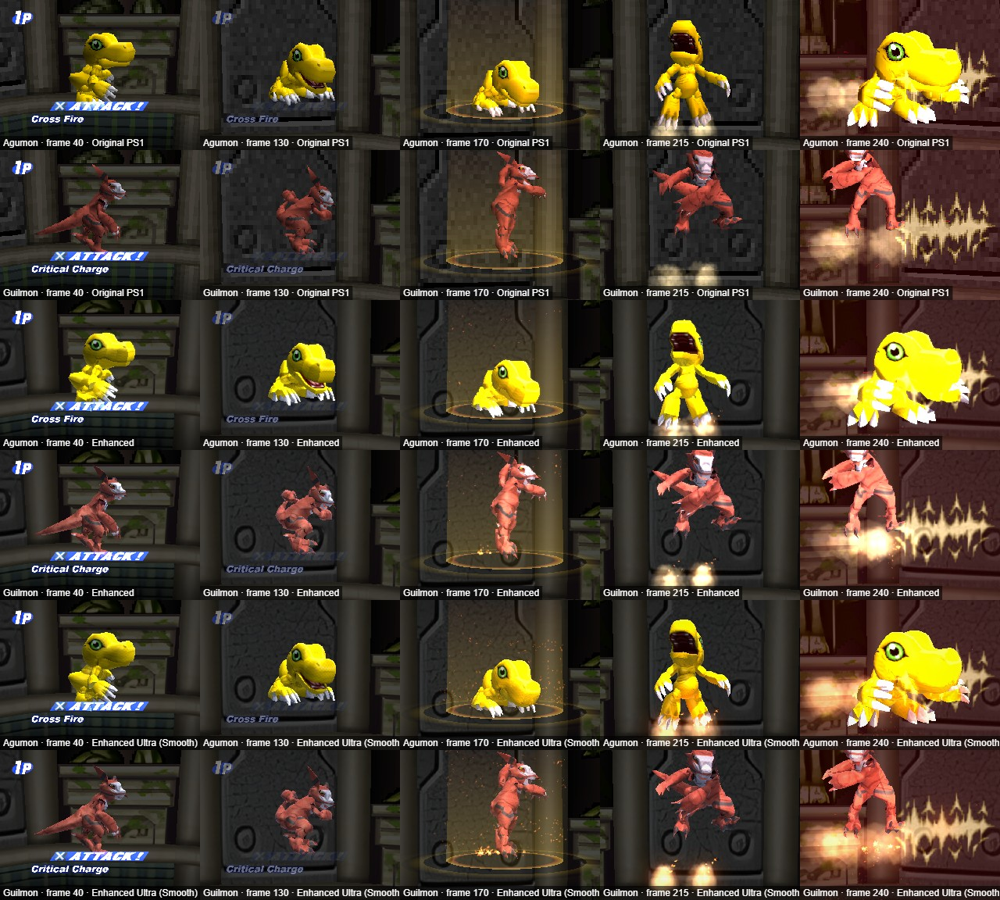
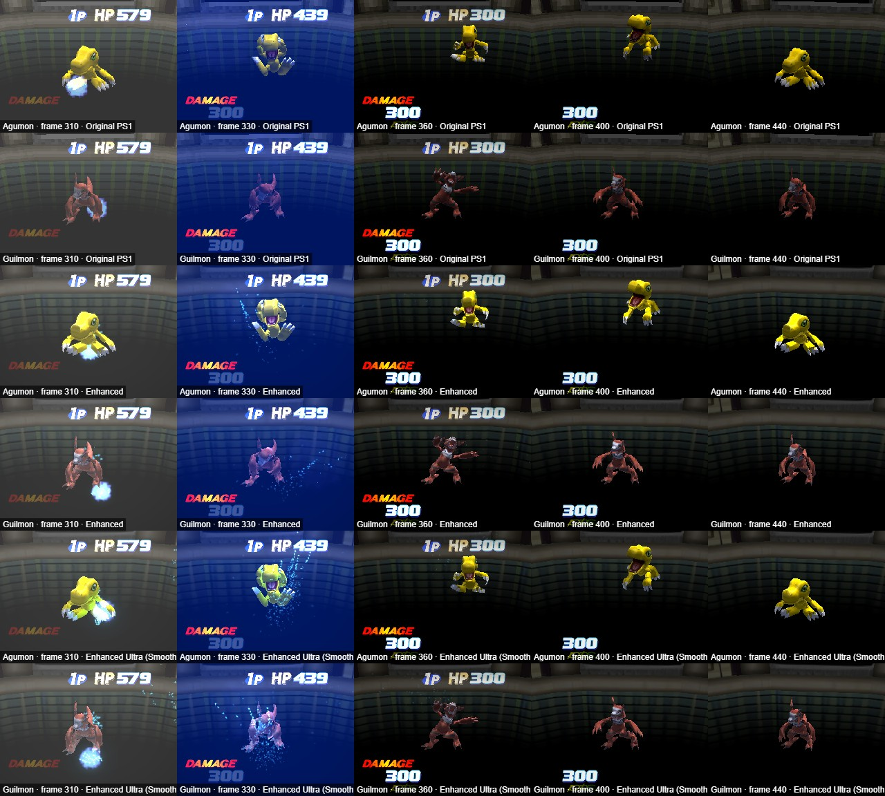
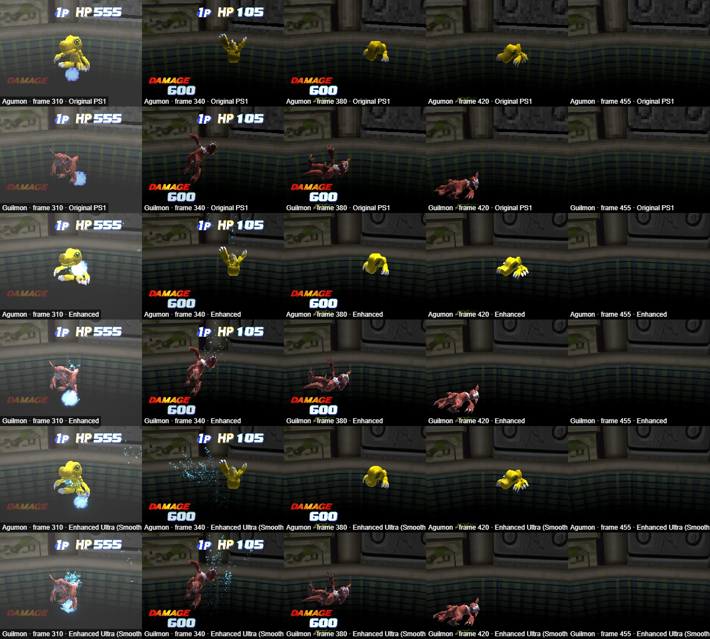
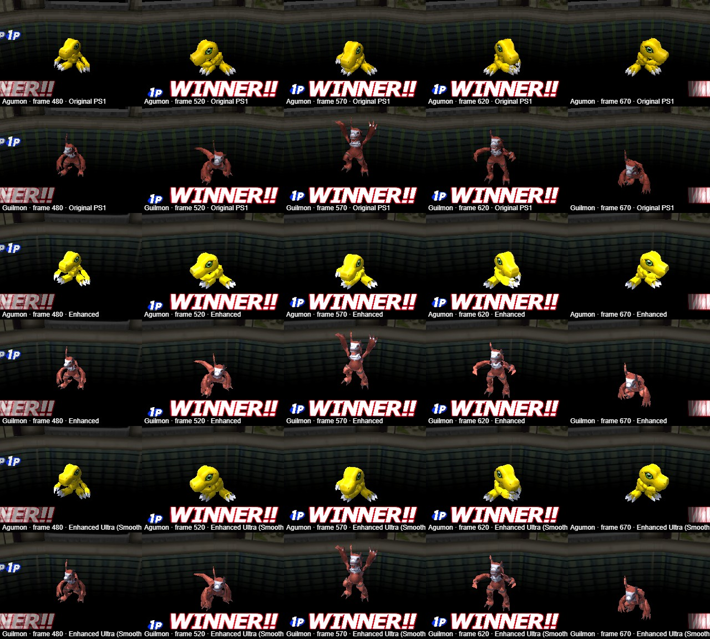

# TS-207: Pilot: Guilmon (302) with its Time Stranger model

| | |
|---|---|
| Trello | https://trello.com/c/Br9ZwXGj |
| Phase | 2 Models |
| Feature branch | `time-stranger` (all 45 new cards complete before merging to `main`) |
| Depends on | TS-101, TS-205, TS-206 |

## Goal

Settle the look on one card with the owner before converting the other 44.

## Context

- Model 401 (Guilmon) from TS-205/TS-206.

## Steps

1. Write model 401 over the placeholder; drop `model.recolour` from the entry.
2. Show the owner screenshots and frames of each attack in Original PS1, Enhanced and Smooth, next to Agumon.
3. Make the changes asked for; repeat.

## Acceptance criteria

- [ ] The owner approves the result.
- [x] All checks of CLAUDE.md and `battletest.js` pass.
- [x] roster.md Phase 2 status for Guilmon is done. (Noted there as converted and waiting for the owner's word.)

## Out of scope

- None.

## Questions for the owner

- Is the look right (size, colours, smoothness, timing)?
- Should an attack's motion be laid so that its strike meets the script's fire, and should the colours be brightened? (See the log.)

## Log

<!-- Date, what was done, what was found and where (addresses, URLs, commits). -->

### 2026-10-14

**Model 401 is Guilmon's own now.** The card's entry in `tools/custom_cards.json` names its
Time Stranger model instead of a recolour, and `tools/build_custom.py` converts it:

```json
"model": {"number": 401, "ts": "chr090", "against": "chr050", "parts": {"0": "J_spine02"}}
```

```bash
tools/.venv/Scripts/python -I tools/build_custom.py extracted web model 302
```

The recolour `ts-302-model` is gone from the list. Built twice, the three files come out
the same byte for byte. What the tool does at each step is in the README, "Time Stranger
models as DDCB models"; that none of it is the PlayStation game's is said there and under
"Not from the game code".

**What was wrong with the model of TS-205/TS-206, and what was changed.** Put into the
battle, that model tore open at every joint and looked thin and small beside Agumon.

| What was seen | Why | What the tool does now |
|---|---|---|
| Arms, legs and tail in shards as soon as a motion played | A triangle went whole to one part, so nothing joined two parts; and the bone with the fewest vertices was merged first, which took the elbows and thighs before the nails | A triangle keeps each corner in its own bone's part and is stretched between them. Bones are merged by how little that moves the surface over the model's motions, the two sides of a pair together |
| Enhanced and Smooth shredded the model once it had such triangles | `refine` (`web/js/battlehd.js`) put a new corner halfway between two corners that are in different parts' coordinates | It measures such a side in the model's coordinates and gives the new corner to the same part from both triangles of the side. All other models' meshes are unchanged (same hash over 256 model files before and after) |
| The tail a broad fan in Enhanced and Smooth | The thinning had made triangles from the hips to the tail's end; their new corners go with one end | A collapse may not join two bones that no edge of the model joins (196 refused for Guilmon) |
| Low detail next to the disc's better models | The figures were Agumon's: 16 parts, 690 triangles, 3 palette rows | **The owner (2026-10-14): Agumon has low detail, compare with Angewomon.** A converted model takes the figures of Angewomon's model 170: 30 parts, 976 triangles, 256×128, 14 rows (`custom.TS_DETAIL`; a card can name another) |
| A blurred, banded texture, eyes that do not read | The whole body was one piece of the sheet, shrunk to 0.254 across and 0.102 down, with one row of 16 colours | Every piece is laid out by its own shape and takes the palette row that fits its colour: 0.154 both ways, 65% of the sheet used, 14 rows. The eyes' pieces are 1.5 times as large |
| Guilmon small beside Agumon | Scaled to Agumon's height, ears and all | Sized against the base as in Time Stranger, where Agumon (`chr050`, found in `data/char_info.mbe`) is 1.743 high and Guilmon 2.170: 312 here against Agumon's 251 |

**Guilmon as built:** 30 parts (33 bones carry vertices; the neck and the two collars were
merged into the chest, part 0), 975 triangles from 7,754, 713 vertices, 493 triangles
between parts, texture 256×128 in 14 palette rows, 8 motions on Agumon's keys.

**Seen in the browser** (`battle-preview.html` served from this worktree, against
Garurumon, first stage, each case stepped frame by frame and drawn at the frames named in
the pictures, in Original PS1, Enhanced and Enhanced Ultra, which draw the model as
written, refined and smooth). No console errors. In every case and style Guilmon's
motions start and end at Agumon's frames: attack motions from frame 2, the damage and KO
motions from 307, the victory motion from 476.















- Guilmon is whole in all three styles: body, limbs and tail joined, the tail bending,
  the face with its white muzzle, black marks and yellow eyes.
- Attacks 1 and 2: Guilmon swings at about frame 110 and is nearly standing again when the
  script's fire comes at 192, at its chest. At frame 150 the camera's close-up, made for
  Agumon's head, shows only Guilmon's raised arm and the top of its head.
- Attack 3: Guilmon is in the air above the script's ring at frame 170, where Agumon
  crouches in it; at 240 the close-up cuts its head.
- Damage: Guilmon stays where it stands; Agumon is thrown back. KO: Guilmon falls and lies
  on the ground. Victory: both arms up at frame 570.

**Checks:** `selftest.js` 31, `decktest.js` 11, `sim.js` 200 matches without a timeout,
`fxtest.js`, `check_paths.py` ok, `time_stranger_design_test.js`, and `battletest.js`: 237
Digimon, 711 attacks in three styles, with a new check that a refined mesh's new corners
lie on their sides (it fails on the old `refine` with "a new corner lies 20.0 from the
middle of its side").

**Not done, not right yet, or for the owner to say:**

- **Timing.** Nothing lays Guilmon's strike on the script's moment: the keys are spread
  evenly over each Time Stranger motion (TS-206). When a Time Stranger motion strikes was
  not looked for in that game's files.
- **The scripts are Agumon's**: a fireball under "Rock Breaker". That is the card's base
  (TS-101), not the converter's.
- **Colours.** The red is the texture's own, a brick red (`984537`); it is duller than
  Agumon's yellow. How Time Stranger's shader lights it was not read. A recolour on top of
  a converted model is not built.
- **Camera.** It is the base's, so a close-up made for Agumon's shape can cut Guilmon.
- Attack 3 ends in the air and the KO ends more than half a turn from the standing pose in
  its numbers, as in TS-206.
- Not looked at: a whole match on the board with Guilmon, the sounds, and the model at the
  site's real speed (everything was stepped).
